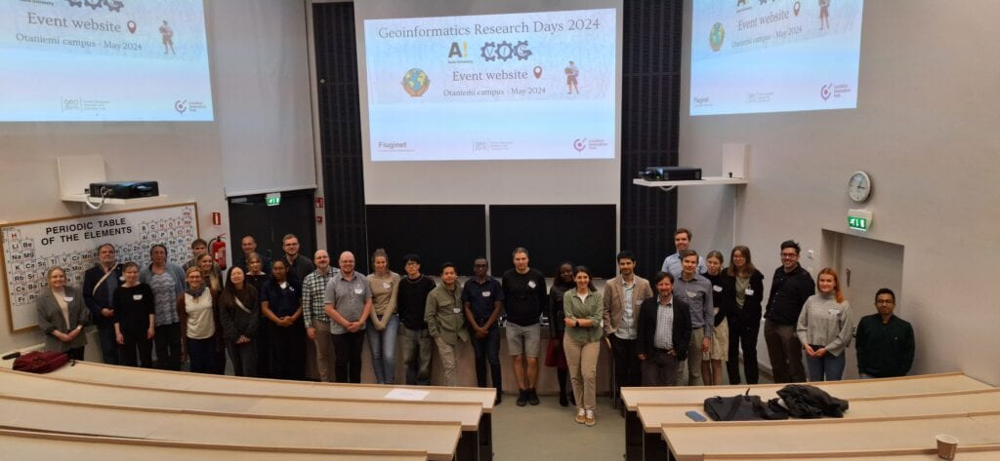

We are excited to share the success of the Geoinformatics Research Days 2024, held on May 20-21 at Aalto University in Espoo, Finland. This annual event, now in its 10th year, brought together scholars and experts from around the globe to present cutting-edge geospatial projects and research.

This year marked a significant transformation, as we developed the event into a full-scale scientific conference. With diverse sessions and fascinating showcases, we explored a wide range of topics, including geospatial mobility, cognitive cartography, GeoAI, and machine learning approaches in spatial data. The program featured keynote presentations from world-renowned experts such as Prof. Enrico Di Minin and Prof. Matti Kummu, who provided invaluable insights into sustainability and the challenges of mapping for a sustainable future.

Thank you to all the participants, sponsors, and organizers who made this event a remarkable success! We look forward to continuing this exciting journey and welcoming even more global talent next year!

