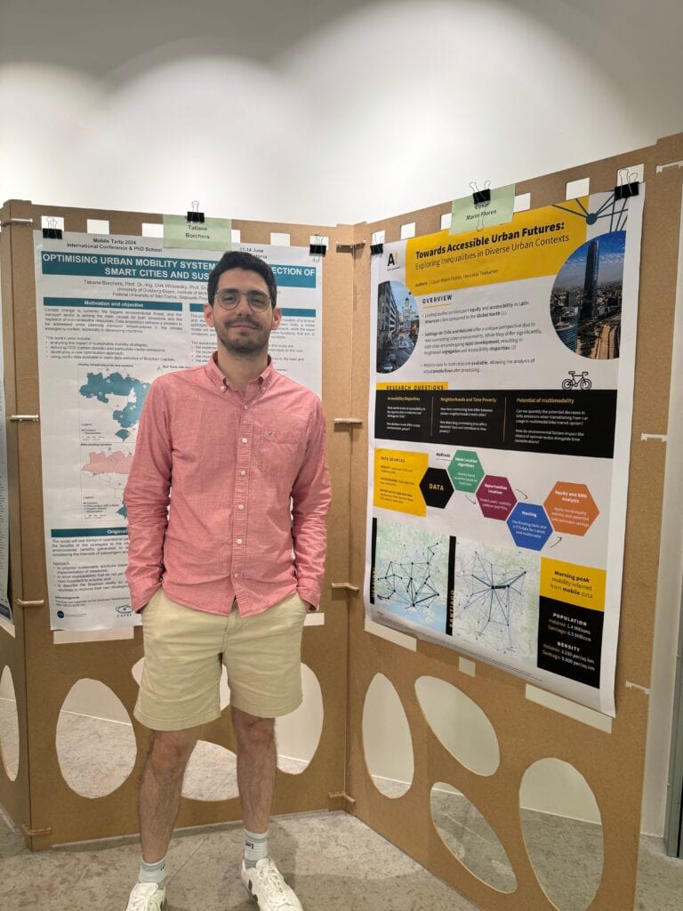
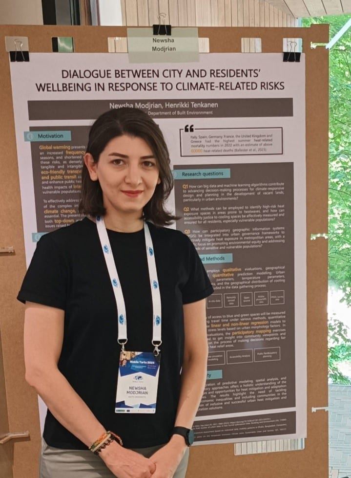
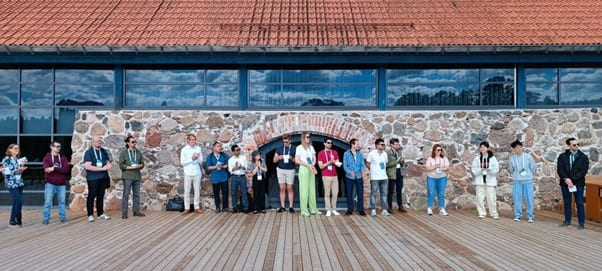
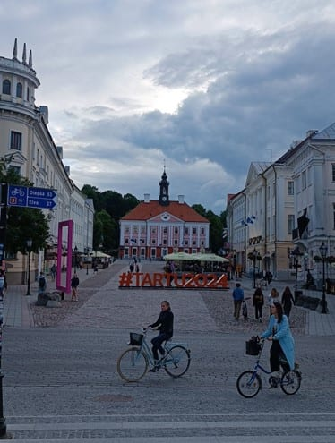
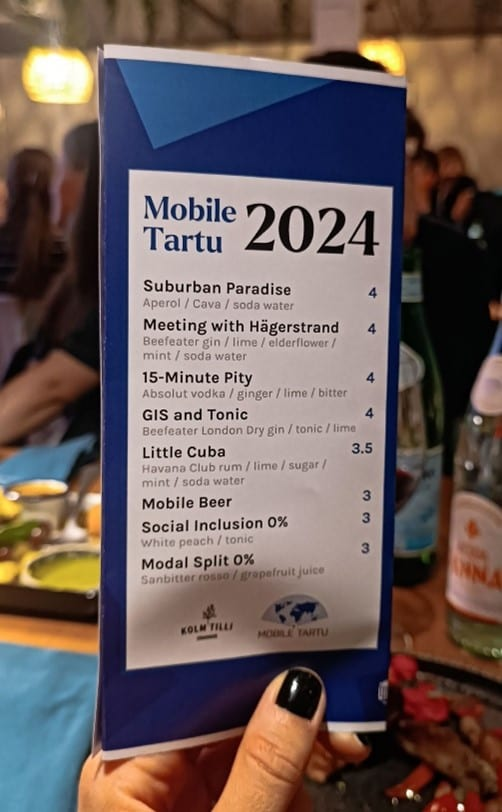

**MAPICO Team at Mobile Tartu Conference: Advancing Sustainable Mobility Research**

Over the past few days, the MAPICO team had the incredible opportunity to participate in the Mobile Tartu Conference, a premier event focused on mobile big data analytics for building just and sustainable societies. The conference brought together a vibrant community of mobility researchers—ranging from early-career scholars to leading experts—as well as professionals from the public and private sectors. Discussions centered around cutting-edge topics such as GPT, Geo-AI, and their transformative role in geoinformatics research.

**Workshop on Sustainable Mobility and Accessibility**

As part of the conference, MAPICO team members Henrikki and Subhrasankha organized a workshop titled “Mobility Data and Network Analysis Tools for Understanding Sustainable Mobility.” The session aimed to equip participants with quantitative methods to analyze sustainable mobility and accessibility using mobile phone data and network analysis tools.

The workshop focused on improving participants’ skills in assessing travel-related carbon emissions through open-source Python libraries. It was an excellent opportunity to expand knowledge and empower researchers with practical tools for fostering sustainable mobility solutions.

**MAPICO at the PhD school**

Our doctoral researchers, Cesar and Newsha, actively participated in the Mobile Tartu PhD School. During poster presentations, they showcased their research plans and received valuable insights and constructive feedback from experts and peers. The PhD School provided a supportive environment for professional growth, skill-building, and collaboration with other researchers.

Beyond the academic discussions, the conference’s social events stood out as a highlight! From creative activities to engaging pop quizzes, these events facilitated meaningful connections and strengthened the sense of community among participants.

We extend our heartfelt thanks to Henrikki and Subhrasankha for their exceptional workshop and to the Mobile Tartu committee at the Mobility Lab, University of Tartu for organizing such a collaborative and inspiring event. The conference has been a fantastic platform for researchers to exchange ideas and learn from one another, fostering innovation in sustainable mobility research.

We’re already looking forward to presenting our future research outcomes at Mobile Tartu!
