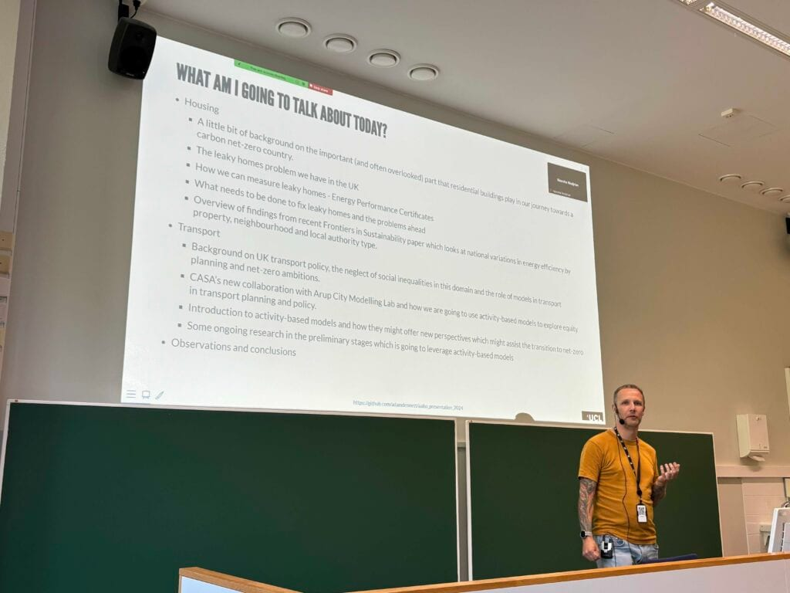
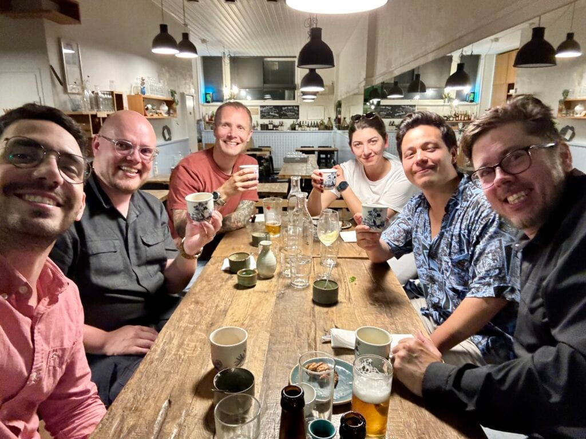

We were happy to host Prof. Adam Dennett from the Centre of Advanced Spatial Analysis (CASA), University College London who is collaborating with GIST Lab related to the Mapico -project. Adam also gave a super interesting talk at the [GeoSPA Seminar Series](https://geospa.org/past-events/). Below are some pictures from this visit.

