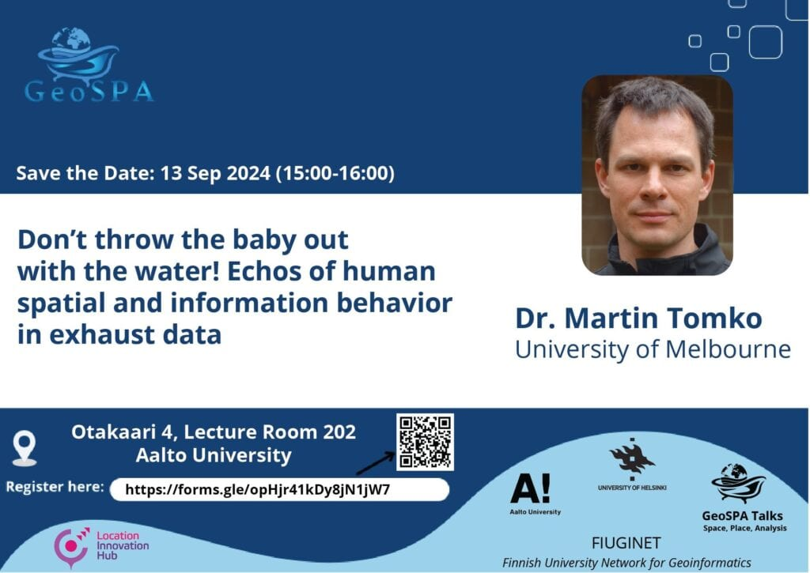

We were happy to host Prof. Martin Tomko from the University of Melbourne, Australia who gave an exciting talk at the [GeoSPA Seminar Series](https://geospa.org/past-events/). A fun fact: Martin was the PhD co-supervisor of our GIST Lab team member Subhrasankha Day. 🙂

