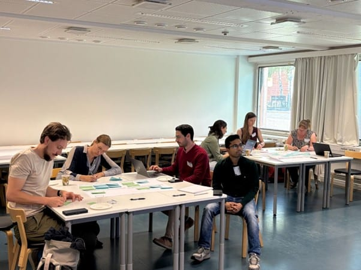
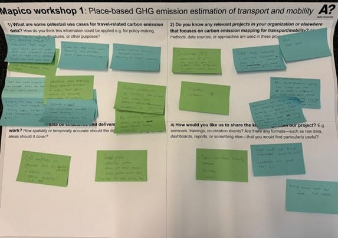

We are delighted to announce the successful initiation of the MAPICO workshops, which began in September 2024. These workshops aim to foster collaboration and innovation among professionals and researchers in urban planning and transport, supporting the broader goals of the MAPICO project.

The first workshop, held on Friday, 20th September 2024, was designed as a co-creation micro-workshop to encourage knowledge exchange. The primary objectives were:

- Introducing the MAPICO Project: Providing participants with an overview of the project’s goals and vision.
- Engaging Stakeholders: Gathering valuable input on how MAPICO’s data and tools can better support transport planning and decision-making to promote sustainable mobility.

The workshop brought together a diverse group of participants, including MAPICO team members from Aalto University’s GIST Lab and external professionals such as researchers, traffic engineers, project managers, and urban planning experts. Participants represented esteemed institutions like the University of Helsinki, Helsingin Kaupunki, Espoon Kaupunki, and the Finnish Environment Institute (SYKE), creating a dynamic environment for meaningful collaboration and knowledge exchange.

The event began with a presentation introducing the MAPICO project and its objectives. Participants were then divided into smaller groups, each facilitated by MAPICO team members, to engage in focused discussions. These sessions provided an excellent platform for exchanging ideas, identifying opportunities, and addressing challenges in transport and urban planning.

The workshop concluded with group presentations, where participants shared their insights and suggestions. These contributions will play a pivotal role in shaping the development of MAPICO’s tools and ensuring they are tailored to meet the needs of professionals in the field.

We are excited about the outcomes of this initial workshop and look forward to hosting more collaborative sessions in the coming months. Together, we can pave the way for sustainable and efficient mobility solutions.

Stay tuned for updates on the MAPICO project and future workshops!
