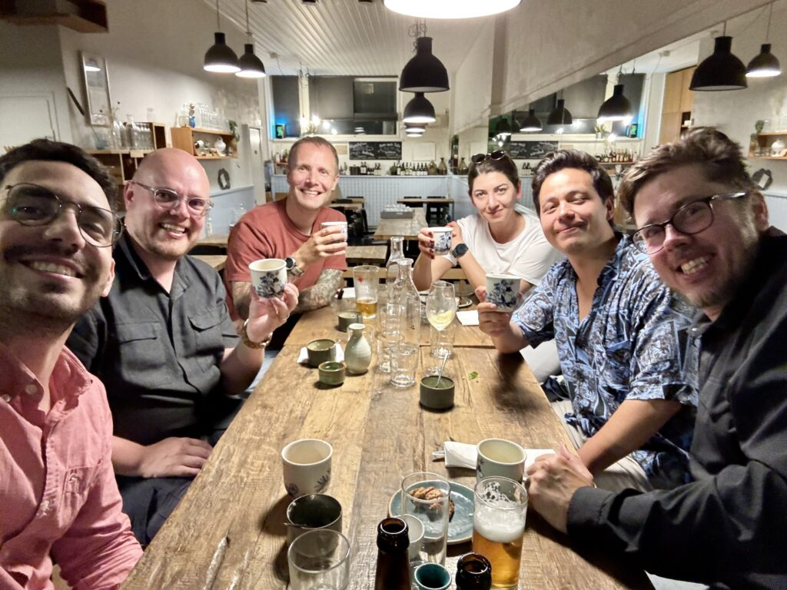
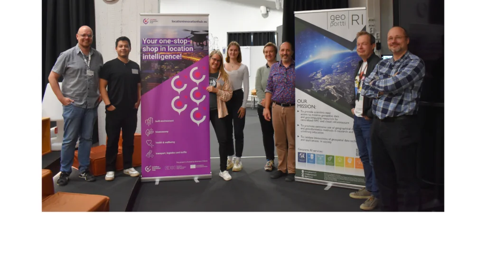
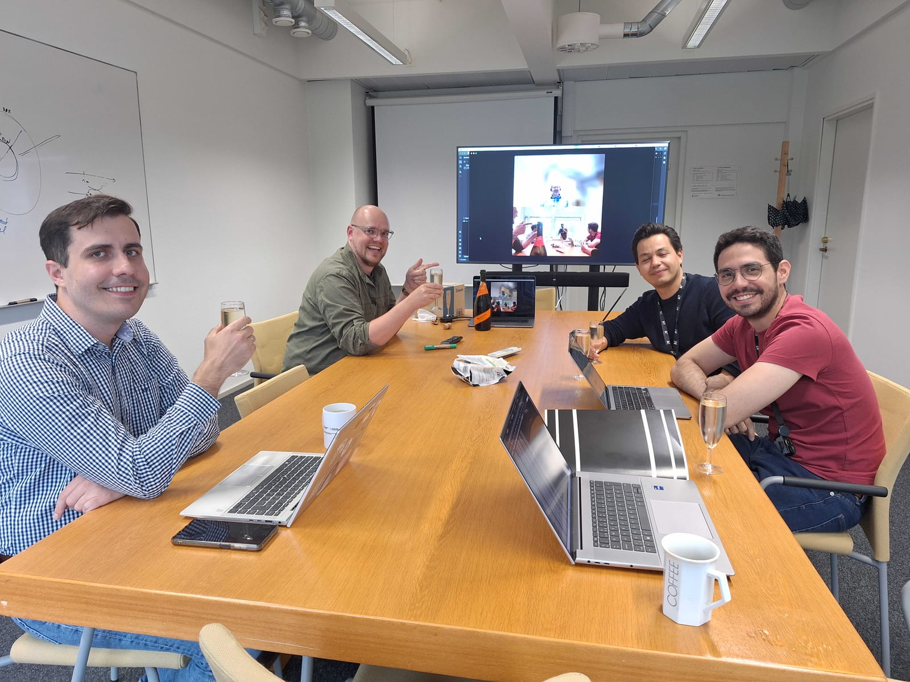

We are sad (but excited at the same time!) to say that our beloved team member Bryan Vallejo will return to his home country Ecuador in September and starts a cool job at Charles Darwin Foundation in Galapagos islands. Bryan has been a dear colleague of ours for many years (both at GIST Lab and previously at Digital Geography Lab, University of Helsinki) and he worked in the [Geoportti](http://geoportti.fi) project as well as the [Location Innovation Hub](http://locationinnovationhub.eu) EDIH as a Technical specialist. Bryan helped our team to develop various GeoHPC related processes and learning materials that are also openly available online, such as [Spatial Data Science for High Performance Computing](http://geohpc.readthedocs.io), [Geospatial Challege Camp](http://challenge-camp.geoportti.fi) and [Spatial Analysis with QGIS.](http://qgis-tutorials.readthedocs.io)

We wish him all the best for the future endeavours in Galapagos! ❤️ Below are some pictures of Bryan over the years at GIST Lab.

