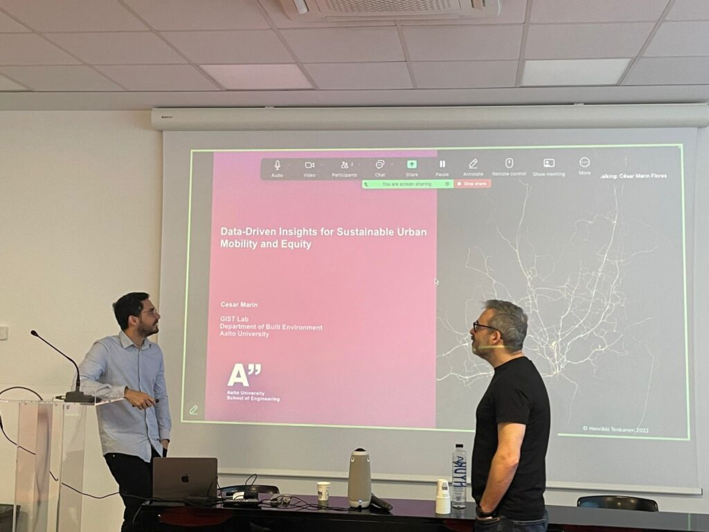

I just returned from a valuable visit to the ISI Foundation in Torino, where I had the opportunity to connect with experts in urban mobility. A highlight was catching up with my PhD co-supervisor, Prof. [Leo Ferres](https://www.linkedin.com/in/leo-ferres-42a53a201/), as we exchanged insights on mobility dynamics, particularly in Latin America and Chile.\
\
During my visit, I shared some recent findings from projects across Finland, Chile, and the Nordics, including the MAPICO project, which maps commute-related carbon emissions at a high spatial level to help cities transition toward sustainability. Torino’s charm, complete with great pizza breaks 🍕, made it an ideal setting for connecting and learning.\
\
Thank you to the team at ISI for the warm welcome and inspiring conversations. I look forward to future collaborations on the journey toward sustainable urban mobility!

César Marin Flores

