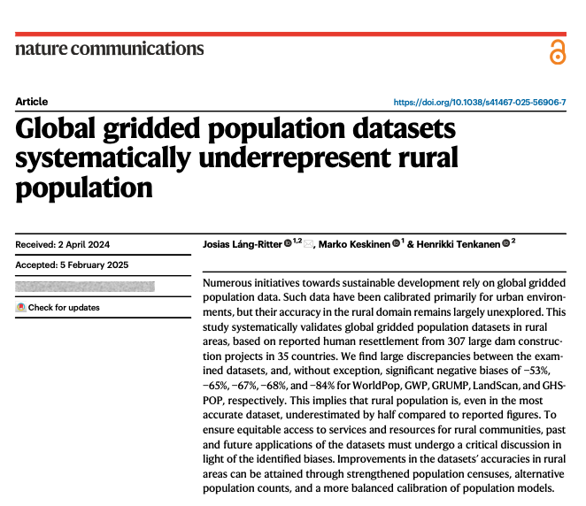

Our latest paper lead by Dr. Josias Láng-Ritter was published at [Nature Communications!](https://doi.org/10.1038/s41467-025-56906-7) Our study reveals that Global population datasets, crucial for decision-making by governments and institutions, underestimate rural populations by as much as 53% to 84%.

Accurate estimation of population distribution is essential for social and environmental decision-making as well as research.  Scientists, governments, and international bodies often rely heavily on global population data for activities ranging from resource allocation and infrastructure planning to disease epidemiology and disaster risk management.

Despite this reliance, current population maps fail to accurately represent realities on the ground, particularly in measuring rural populations. In this study, we are the first to show the striking and systematic extent to which these datasets underestimate rural population figures worldwide.

‘We examined ground-truth reports on the displacement of people due to dam projects and were surprised to find that the actual population living in rural areas is much higher than the global population data indicates. Depending on the dataset, rural populations were underestimated by between 53% to 84%,’ says postdoctoral researcher **Josias Láng-Ritter**.

With around 43 percent of the world’s estimated 8.2 billion people living in rural areas, the new findings have far-reaching consequences. Official population estimates published by the UN and the World Bank rely on the same national censuses that are the basis for the flawed population maps.

‘For the first time, our study provides strong evidence that a significant proportion of the rural population may be missing from current global population estimates,’ says Láng-Ritter.

**Read the full article here:**

Láng-Ritter, J., M. Keskinen & H. Tenkanen (2025). Global gridded population datasets systematically underrepresent rural population. *Nature Communications. [https://doi.org/10.1038/s41467-025-56906-7](https://doi.org/10.1038/s41467-025-56906-7)*

## Podcast

In case you are not into reading, you can also listen an AI generated podcast (done with NotebookLM) that covers nicely the key insights of our paper in 10 minutes:

[Listen to the podcast on YouTube](https://www.youtube.com/watch?v=yRLSoVw15mg)

## Media coverage

We are delighted that our study has received fair amount of interest in the media across the world. Below are published news stories related to the paper (updating).

**Finland**

- [YLE News](https://yle.fi/a/74-20149610)
- [YLE TV evening news](https://areena.yle.fi/1-72361977?seek=1012)
- [Maaseudun tulevaisuus](https://www.maaseuduntulevaisuus.fi/uutiset/9d0dbd8b-b328-47a8-ae88-ac67e883f5c0)
- [Helsinki Times](https://www.helsinkitimes.fi/176-information/study/26295-global-datasets-may-miss-half-of-rural-populations-study-finds.html)
- [Kauppalehti](https://www.kauppalehti.fi/lehdistotiedotteet/embargo-significant-proportion-of-worlds-rural-population-missing-from-global-estimates-says-study/7250eb26-c076-5904-8467-c7bc6b6f0d48)
- [Hufvudstadsbladet](https://www.hbl.fi/artikel/dubbelt-fler-an-man-trott-kan-bo-pa-landsbygden/)
- [STT](https://www.sttinfo.fi/tiedote/70981892/pysayttava-tutkimustulos-maailman-maaseutualueilla-asuu-paljon-luultua-enemman-ihmisia?publisherId=37936456&lang=fi) (press release)
- [Aalto University](https://www.aalto.fi/en/news/significant-proportion-of-worlds-rural-population-missing-from-global-estimates-says-study)

**International**

1. [Die Welt](https://www.welt.de/wissenschaft/article255734926/Weltbevoelkerung-Mehr-Menschen-als-gedacht-leben-auf-der-Erde.html) (Germany)
2. [Tages Spiegel](https://www.tagesspiegel.de/sind-wir-wirklich-nur-82-milliarden-warum-die-weltbevolkerung-grosser-sein-konnte-als-gedacht-13393201.html) (Germany)
3. [Stuttgarter Zeitung](https://www.stuttgarter-zeitung.de/inhalt.8-2-milliarden-oder-leben-noch-mehr-menschen-auf-der-erde.926e3cad-70a8-4799-b479-5d8460581cb6.html) (Germany)
4. [WinFuture](https://winfuture.de/news,149662.html) (Germany)
5. [GEO](https://www.geo.de/wissen/weltbevoelkerung-koennte-weitaus-groesser-sein-als-gedacht-35564656.html) (Germany)
6. [Frankenpost](https://www.frankenpost.de/inhalt.8-2-milliarden-oder-leben-noch-mehr-menschen-auf-der-erde.926e3cad-70a8-4799-b479-5d8460581cb6.html) (Germany)
7. [NTV](https://www.n-tv.de/wissen/Weltbevoelkerung-koennte-deutlich-groesser-sein-als-gedacht-article25642635.html) (Germany)
8. [The Independent](https://www.independent.co.uk/news/science/world-population-billions-undercounted-controversy-b2718400.html) (UK)
9. [New Scientist](https://www.newscientist.com/article/2472604-have-we-vastly-underestimated-the-total-number-of-people-on-earth/) (US/UK)
10. [Phys.org](https://phys.org/news/2025-03-significant-proportion-world-rural-population.html) (UK)
11. [Canaltech](https://canaltech.com.br/ciencia/populacao-mundial-pode-ser-muito-maior-do-que-imaginavamos/) (Brazil)
12. [Olhar Digital](https://olhardigital.com.br/2025/03/19/ciencia-e-espaco/quantos-somos-realmente-no-mundo/) (Brazil)
13. [ZME Science](https://www.zmescience.com/science/news-science/are-there-billions-more-people-than-we-thought-controversial-study-suggests-rural-population-may-be-undercounted-by-50/) (Romania)
14. [El Mundo](https://www.elmundo.es/ciencia-y-salud/ciencia/2025/03/18/67d94690e85ece39258b4599.html) (Spain)
15. [ORF](https://science.orf.at/stories/3229311/) (Austria)
16. [Futura](https://www.futura-sciences.com/planete/actualites/population-mondiale-population-mondiale-chiffre-officiel-serait-faux-millions-personnes-ont-ete-ignorees-revele-etude-120483/#xtor%3DRSS-8) (France)
17. [MSN](https://www.msn.com/en-us/news/technology/oops-scientists-may-have-severely-miscalculated-how-many-humans-are-on-earth/ar-AA1BfkE2?ocid=Peregrine) (US)
18. [Infobae](https://www.infobae.com/america/ciencia-america/2025/03/20/la-tierra-tiene-mas-de-8-mil-millones-de-habitantes-un-estudio-sugiere-que-los-datos-globales-subestimaron-la-cifra-real/) (Argentina)
19. [WION](https://www.wionews.com/world/human-population-on-earth-more-than-82-billion-people-8872274) (India)
20. [24.HU](https://24.hu/tudomany/2025/03/20/globalis-nepesseg-populacio-hiba-videki-lakossag/) (Hungary)
21. [Popular Mechanics](https://www.popularmechanics.com/science/environment/a64222314/human-population-count/)
22. [AOL](https://www.aol.com/oops-scientists-may-severely-miscalculated-143000111.html?guccounter=1)
23. [YAHOO News](https://www.yahoo.com/news/oops-scientists-may-severely-miscalculated-143000821.html)
24. [Science Magazine](https://scienmag.com/study-reveals-large-segment-of-rural-population-overlooked-in-global-estimates/)
25. [Life Technology](https://www.lifetechnology.com/blogs/life-technology-science-news/global-population-data-underestimates-rural-figures?srsltid=AfmBOoo4jVDmtLngnzaQC09wpMQRk9Ee6gXtbUsIYgWAlpHwyRuDnGwr)

#### Statement: Misinterpretations in media

We have been delighted to see that this work has attracted a lot of interest in the international media. Unfortunately, some of these stories (not all) claim something that we have systematically declined to answer, i.e. “what is the world’s population?” Based on our study alone, it is not possible to give such an estimate, and **further research is needed to evaluate the implications of our discovery in broader context**. This is something we hope to pursue in the future.

The fact is that we have not estimated the number of global population in our study, and have not given such number anywhere or to anyone. Thus, if you see a news article that claims us saying a specific number for the global population, it is their own interpretation and not something that we have stated.
