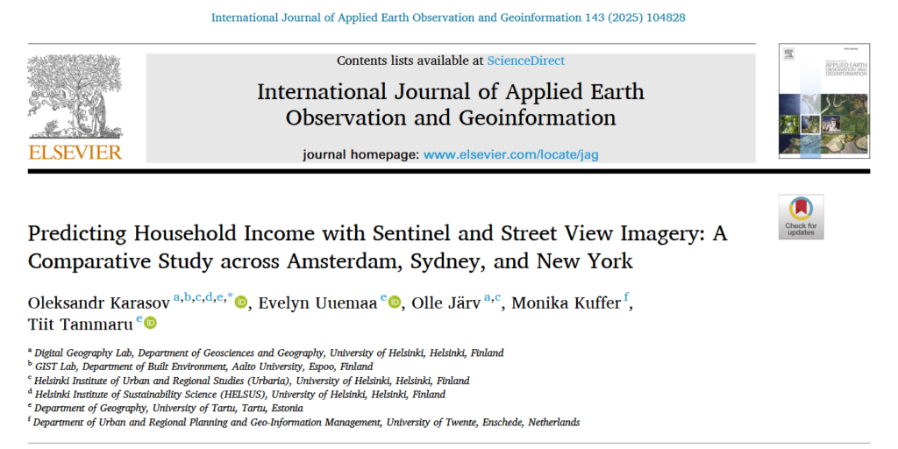

[Oleksandr](/people/oleksandr-karasov/) lead-authored a paper published in the *International Journal of Applied Earth Observation and Geoinformation*. In this paper, Oleksandr and the international team of authors ([Evelyn Uuemaa](https://landscape-geoinformatics.ut.ee/team/evelyn_uuemaa/) and [Tiit Tammaru](https://ut.ee/et/tootaja/tiit-tammaru) from the University of Tartu, [Olle Järv](https://researchportal.helsinki.fi/fi/persons/olle-j%C3%A4rv/) from the University of Helsinki, [Monika Kuffer](https://people.utwente.nl/m.kuffer) from the University of Twente) investigated the spatial distribution of household income across three global cities: Amsterdam, New York, and Sydney, using a machine-learning approach based on Sentinel satellite and Google Street View imagery.

They examined how the built environment and landscape patterns reflect the socioeconomic status of neighborhoods, and found that six specific indicators related to moisture, color, and surface textures are common predictors of income across all these three distinct cities. The article also shows that freely available Sentinel-based spatial indicators offer greater explanatory power than visual street-level data, making it the primary data choice for data-restricted regions. The evaluation demonstrates that this scalable approach has great potential for providing timely, high-resolution monitoring of urban economic inequalities between traditional census cycles.

The paper is available open access here: [https://doi.org/10.1016/j.jag.2025.104828](https://doi.org/10.1016/j.jag.2025.104828)
