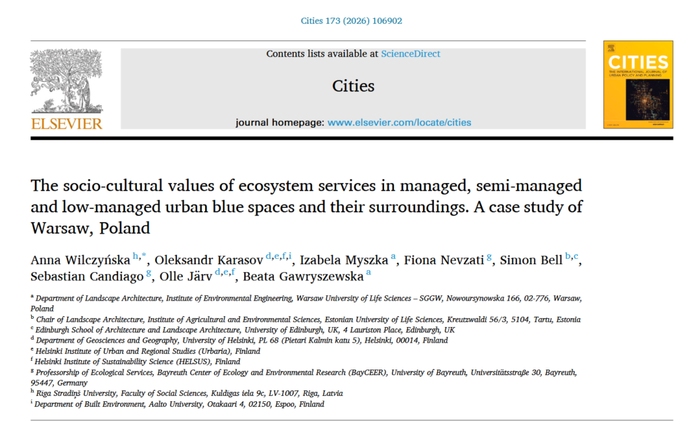

We are happy to share that [Oleksandr](/people/oleksandr-karasov/) recently co-authored a paper published in the journal *Cities*. In this paper, the authors investigated the socio-cultural values of ecosystem services in managed, semi-managed, and low-managed urban blue spaces in Warsaw, Poland, using participatory mapping (PPGIS) data. The work was led by the [Anna Wilczyńska](https://science.rsu.lv/en/persons/anna-wilczynska/) from the Rīga Stradiņš University, and done in great collaboration with an international team from the Warsaw University of Life Sciences ([Izabela Myszka](https://bw.sggw.edu.pl/info/author/WULSed9b9fa0ddea4657a1489a6c2c4baf42) and [Beata Gawryszewska](https://bw.sggw.edu.pl/info/author/WULSe155520022ea4913b2ab67121a0551d2)), the University of Bayreuth ([Sebastian Candiago](https://www.pes.uni-bayreuth.de/en/professorship/team/candiago-sebastian/index.php), [Fiona Nevzati](https://www.pes.uni-bayreuth.de/en/professorship/team/nevzati-fiona/index.php)), University of Helsinki ([Olle Järv](https://researchportal.helsinki.fi/fi/persons/olle-j%C3%A4rv/)), the Estonian University of Life Sciences and the University of Edinburgh ([Simon Bell](https://www.emu.ee/en/contacts/simon-bell))!

The study examines residents’ perceptions of the benefits (ecosystem services) provided by these spaces. It reveals five distinct clusters of ecosystem services based on their values. The article also shows that while managed parks are heavily valued for social bonding and aesthetics, low- and semi-managed areas play a crucial role in relaxation and nature connection. Therefore, these low-intervention areas have great potential as “Informal Blue Spaces” within the urban infrastructure without high-cost management input. Overall, the results support integrating a diversity of blue spaces into urban planning and policy frameworks.

The paper is available open access here: [https://doi.org/10.1016/j.cities.2026.106902](https://doi.org/10.1016/j.cities.2026.106902)
