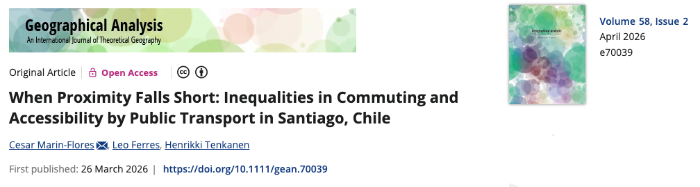

We are excited to share that our latest paper, led by doctoral researcher [Cesar Marin-Flores](/people/cesar-marin-flores/), has been published in *Geographical Analysis*. The study examines commuting patterns and public transport accessibility in Santiago, Chile, and shows that living close to opportunities does not guarantee the ability to reach them.

Public transport accessibility is widely used to assess how well cities connect people to jobs, schools, and services. Proximity to stops and routes is often treated as a reliable proxy for opportunity. However, this study reveals a fundamental gap in that assumption: low-income residents in Santiago spend similar amounts of time commuting as their higher-income counterparts, yet they consistently show substantially lower levels of accessibility. To capture this dynamic, the study uses eXtended Detail Records (XDRs) from mobile phone activity, rather than traditional surveys or static models. This data allows the identification of real residential and work locations at the city scale, with commuting routes modeled through the R5 multimodal routing engine for public transport and walking. Spatial patterns are then analyzed using bivariate local indicators of spatial association (LISA) alongside regression techniques, revealing where low accessibility clusters with vulnerable population groups.

> *‘*While average public transport commuting times do not differ significantly across socioeconomic groups, marked inequalities emerge when accessibility is considered. High-income neighborhoods consistently exhibit high accessibility, whereas low-income areas show substantially lower levels.*‘*

The findings also highlight significant disparities across sociodemographic groups. The analysis also identifies significant disparities across sociodemographic groups, particularly for Indigenous populations and in relation to gender. The approach is scalable and can be applied to other cities or used to evaluate the effects of urban transport interventions over time. Congratulations to Cesar on his first-author publication, and to all collaborators who contributed to this work!

The paper is available open access here: [https://onlinelibrary.wiley.com/doi/10.1111/gean.70039](https://onlinelibrary.wiley.com/doi/10.1111/gean.70039)
