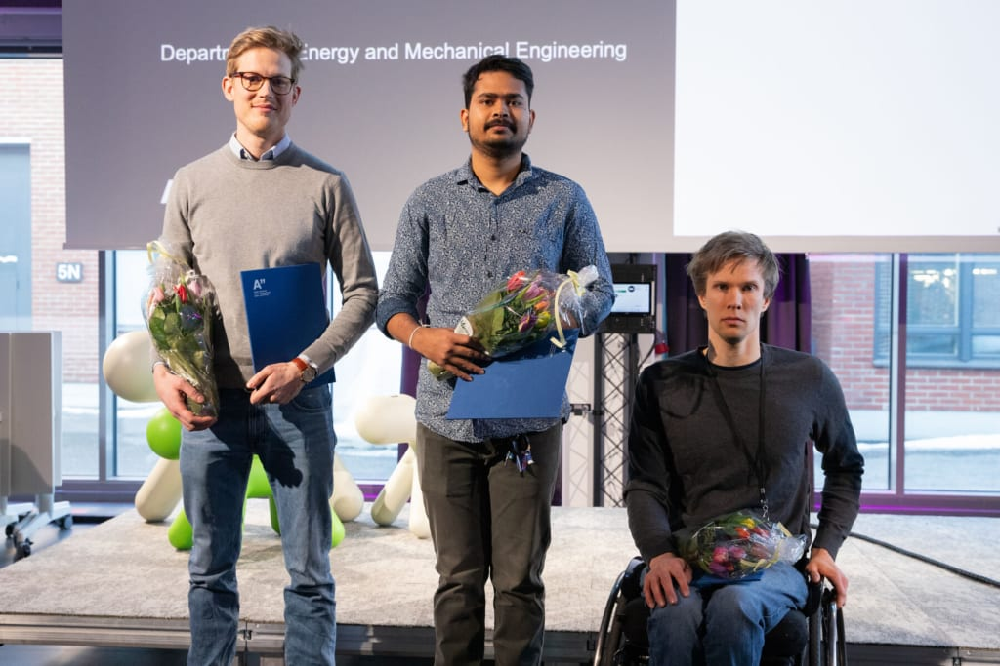

We are proud to share that [Josias Láng-Ritter](/people/josias-lang-ritter/) has received the Publication Award at this year’s School of Engineering Annual Awards (ENG Awards 2026). The event was hosted by Dean Kari Tammi on 5 March at the Stage in the Viima building in Otaniemi, and brought together staff and students to celebrate outstanding contributions across education, research, and service.

*Publication Award recipients Josias Láng-Ritter, Soumya Roy, and Topias Tyni*

The Publication Award recognises the finest research outputs from the School of Engineering each year. Josias was honoured for his paper published in *Nature Communications*, co-authored with Marko Keskinen and Henrikki Tenkanen, which demonstrates that global gridded population datasets systematically underestimate rural populations worldwide.

Congratulations to Josias on this well-deserved recognition, and to all others celebrated at ENG Awards 2026!

**Read the full article here:**

Láng-Ritter, J., M. Keskinen & H. Tenkanen (2025). Global gridded population datasets systematically underrepresent rural population. *Nature Communications. [https://doi.org/10.1038/s41467-025-56906-7](https://doi.org/10.1038/s41467-025-56906-7)*
