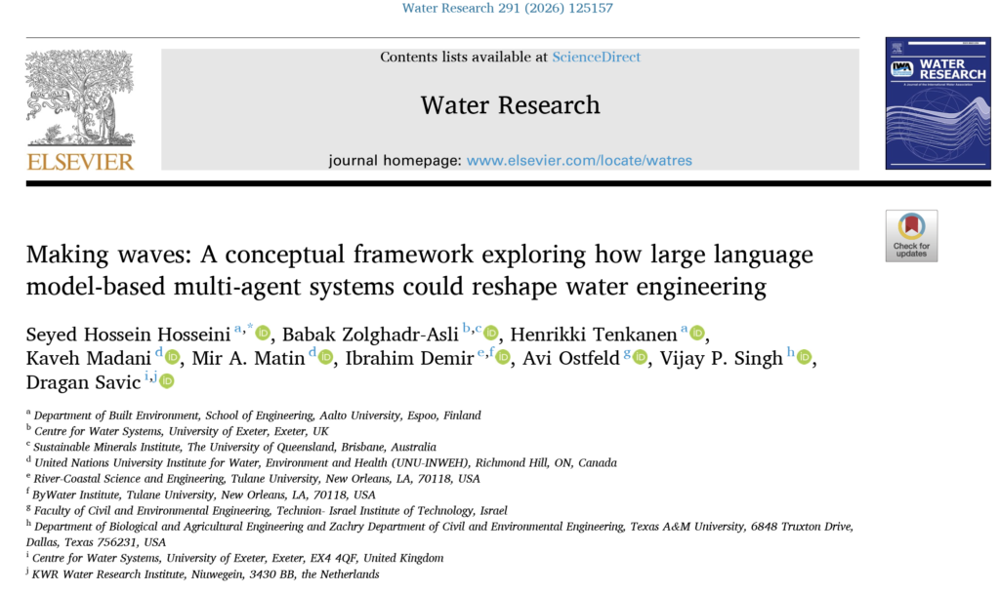

We are happy to share a new open-access paper led by doctoral researcher [Seyed Hossein Hosseini](/people/seyed-hossein-hosseini/), published in *Water Research*. The study presents a conceptual framework for integrating Large Language Model-based Multi-Agent (LLM-MA) systems into water engineering, exploring both the opportunities these systems offer and the challenges that come with them.

Water engineering is inherently complex. It involves managing large volumes of data from diverse sources, coordinating across disciplines and institutions, and making decisions that often need to be both technically sound and politically navigable. In many cases, these tasks must happen in real time. LLM-MA systems, where multiple specialized AI agents work in coordination, are well-suited to this kind of environment. The paper examines how such systems could support groundwater monitoring, irrigation scheduling, flood management, water quality assessment, and infrastructure diagnostics, among other applications.

> *‘Instead of a simple alert code, an LLM-MA can deliver semantically rich messages such as: “Increased turbidity at Node X correlates with upstream rainfall event Y and recent construction permit Z.”‘*

The framework also addresses the limitations and risks that come with adopting these systems. Key challenges include data availability, computational demands, reliability of model outputs, and questions around data governance and ethics — all of which require careful consideration before deployment in real-world water engineering contexts. The paper proposes practical recommendations for responsible adoption, including federated learning to protect data privacy, verifier agents to cross-check outputs, and modular fine-tuning techniques to reduce computational overhead. It also calls for domain-specific benchmarks to properly evaluate LLM-MA performance in water engineering contexts.

This is a collaborative effort involving researchers from Aalto University, the University of Exeter, the University of Queensland, the United Nations University, Tulane University, Technion, Texas A&M, and KWR Water Research Institute. Congratulations to Seyed and all co-authors on this publication!

The paper is available open access here: [https://www.sciencedirect.com/science/article/pii/S0043135425020603](https://www.sciencedirect.com/science/article/pii/S0043135425020603)\
