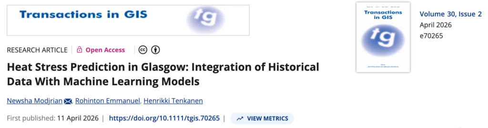

We are glad to share a new open-access paper led by doctoral researcher [Newsha Modjrian](/people/newsha-modjrian/), published in *Transactions in GIS*. The study investigates how vegetation and built form shape urban heat stress in Glasgow, combining historical geospatial data, machine learning, and microclimate simulations to assess the thermal impacts of different greening scenarios on vacant and derelict land.

As cities warm under climate change, understanding where heat stress is most severe and what can realistically reduce it becomes critical for urban planning. Glasgow faces increasing heatwave exposure, and with over 667 vacant plots covering more than 5% of the city’s land area, these underused sites represent a concrete opportunity for targeted greening interventions. The study uses Artificial Neural Network (ANN)-based models to predict Land Surface Temperature (LST) and Mean Radiant Temperature (MRT), and benchmarks these against ENVI-met microclimate simulations across three greening scenarios: full vegetation cover, a mixed approach, and full conversion to built-up surfaces.

> *‘Scenario-based simulations showed that 100% vegetation on vacant lands significantly reduces local thermal conditions, with LST decreasing by 8.7°C and the Universal Thermal Climate Index (UTCI) by 3.3 K. In contrast, full conversion to built-up surfaces increases LST by 1.2°C and raises UTCI by up to 6 K.’*

The ANN model substantially outperformed conventional linear regression in predicting both LST and MRT, with vegetation indices, sky view factor, and building surface fraction emerging as the most influential predictors. Despite the pronounced local cooling effects of greening, the study finds that the net impact at the city-wide scale remains limited. This points to a key planning implication: greening strategies need to be spatially targeted and designed in relation to the specific morphology and radiative environment of each site, rather than applied uniformly across the city.

This work is part of the MAPICO project, funded by the Research Council of Finland, and was carried out in collaboration with the Research Centre for Built Environment Asset Management (BEAM) at Glasgow Caledonian University. Congratulations to Newsha and all co-authors on this publication!

The paper is available open access here: [https://onlinelibrary.wiley.com/doi/10.1111/tgis.70265](https://onlinelibrary.wiley.com/doi/10.1111/tgis.70265)
