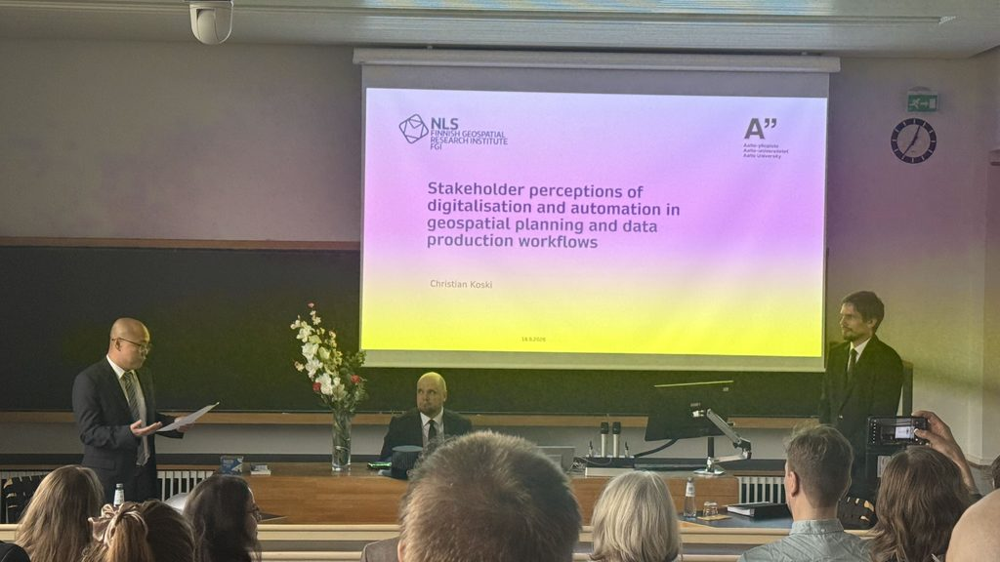

We are pleased to share that Christian Koski successfully defended his doctoral thesis on 18 September 2026 at Aalto University. The thesis, titled *Stakeholder Perceptions of Digitalisation and Automation in Geospatial Planning and Data Production Workflows*, was supervised by Assistant Professor Henrikki Tenkanen, with advisors Professor Juha Oksanen and Dr. Pyry Kettunen from the Finnish Geospatial Research Institute. Professor Haosheng Huang from Ghent University served as opponent.

The thesis examined how stakeholders perceive collaborative GIS in maritime spatial planning and AI-based automation in topographic data production. The research highlights key factors shaping trust, perceived usefulness, and acceptance of these technologies, and identifies transparency and comprehension as important barriers to adoption.

Congratulations to Christian on this achievement, and our thanks to all supervisors, examiners, and contributors!

## Publications

- Koski, C., Rönneberg, M., Kettunen, P., Eliasen, S., Hansen, H. S., & Oksanen, J. (2021). Utility of collaborative GIS for maritime spatial planning: Design and evaluation of Baltic Explorer. *Transactions in GIS*, 25(3), 1347–1365. [DOI: 10.1111/tgis.12732](https://doi.org/10.1111/tgis.12732)
- Koski, C., Rönneberg, M., Kettunen, P., Armoškaitė, A., Strake, S., & Oksanen, J. (2021). User experiences of using a spatial analysis tool in collaborative GIS for maritime spatial planning. *Transactions in GIS*, 25(4), 1809–1824. [DOI: 10.1111/tgis.12827](https://doi.org/10.1111/tgis.12827)
- Koski, C., Kettunen, P., Poutanen, J., Zhu, L., & Oksanen, J. (2023). Mapping small watercourses from DEMs with deep learning — exploring the causes of false predictions. *Remote Sensing*, 15(11), 2776. [DOI: 10.3390/rs15112776](https://doi.org/10.3390/rs15112776)
- Koski, C., Kettunen, P., Tenkanen, H., & Oksanen, J. (in press, 2026). Trust in artificial intelligence to extract geospatial features for topographic databases. *International Journal of Geographical Information Science*. [DOI: 10.1080/13658816.2026.2716279](https://doi.org/10.1080/13658816.2026.2716279)
