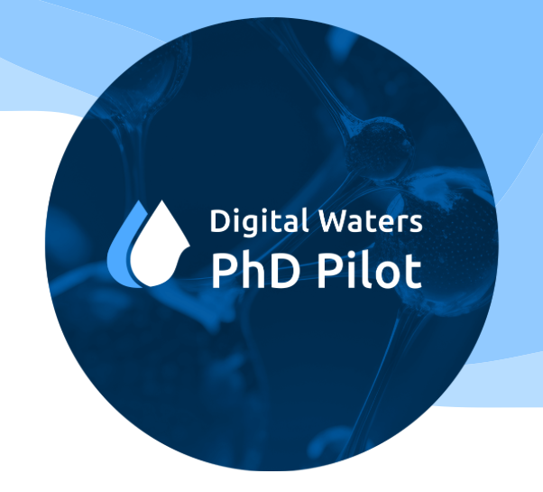
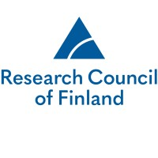
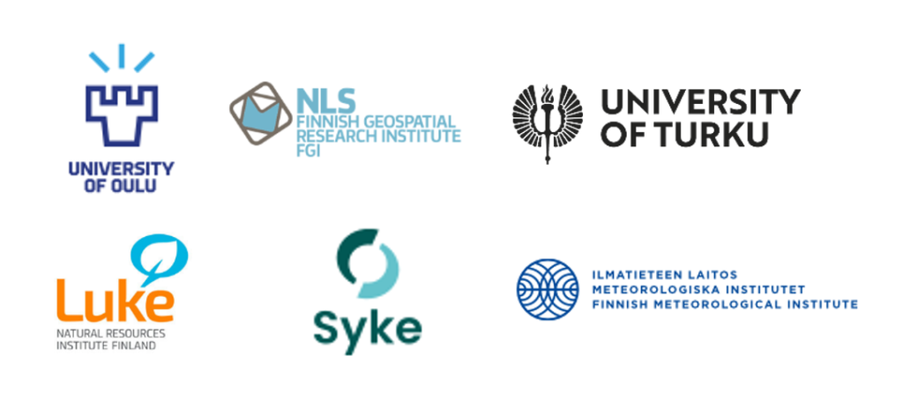

## Project description

[**Digital Waters (DIWA)**](http://digitalwaters.fi) flagship is a leading research and innovation ecosystem, bringing research and new innovations to support decision-making and management in the water sector – digitally.

DIWA’s goal is to secure water for people and ecosystems by implementing integrated and sustainable practices. DIWA aims to become a top-tier water research cluster and innovation ecosystem that generates high-impact research outputs, input to policy development and innovations arising from the next industrial revolution. DIWA aims to cultivate a new generation of water sector leaders skilled to address urgent water related challenges.

DIWA’s doctoral education pilot aims to respond to the growing need of doctoral-level experts in the Digital Waters Flagship area. DIWA PhD pilot is a program that offers a structured doctoral education path that equips the PhD researchers with the necessary skills to become a game-changer in water research and innovation.

### Our role

GIST Lab is participating to the DIWA PhD pilot by supervising one position focusing on spatial modelling of water balance in agricultural fields and the surrounding environment.

## Funders

## Partners

