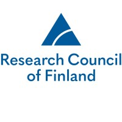

## Project description

Recent Artificial Intelligence (AI) research has given rise to a paradigm shift brought by Large Language Models (LLMs). Though LLMs have taken mostly their root in Natural Language Processing (NLP), it is well-known today that zero-shot and few-shot transfer learning methodologies make their deployment possible beyond the NLP field, achieving impressive performance on a significant range of domains and downstream tasks.  However, the deployment of LLMs in geographic information systems is still in early stages.

The Geo-R2LLM project moves towards a novel paradigm for building knowledgeable and multimodal geographic LLMs by rethinking LLMs generation mode with retrieval and reasoning over multiple multimodal external knowledge sources to ground the prediction. The improved multimodal geographic LLMs will be integrated in a geospatio-temporal artificial intelligence (GeoAI) system prototype and evaluated on a pilot related to context-aware navigation system in a complex urban environment. Navigation services can be considered as one of the most critical and widely adopted location-based services in modern societies, hence the project has potentially strong impact also outside of academia.

The project aims to advance multiple disciplines spanning GeoAI, spatial and spatio-temporal reasoning, information retrieval, and natural language understanding, laying the groundwork for more effective AI platforms for various domains that relate to geography and geographical information science.

## Collaborators

In the project, we will also collaborate closely with Prof. Nico Van de Weghe from the [GeoAI Research Center](https://geoaiugent.wordpress.com) (Ghent University) who is a co-supervisor for the hired PhD researcher.

## Partners

| Role | Country | Institution | Project Team |
|---|---|---|---|
| Coordinator | France | IRIT, University Toulouse | Prof. Lynda Tamine Dr. Jose G. Moreno |
| Partner | Finland | Department of Built Environment, Aalto University | Dr. Henrikki Tenkanen Dr. Subhrasankha Dey |
| Partner | Spain | UPV-EHU, University of the Basque Country | Prof. Eneko Agirre Dr. Gorka Azkune |
| Partner | United Kingdom | University of Leeds | Prof. Anthony G. Cohn |
| Partner | Belgium | Ghent University | Prof. Nico Van de Weghe Lars De Sloover |

## Project Outcome

The project has produced its first major research outcome through the development of **GROKE — Graph-based Reasoning over OSM Knowledge for instruction Evaluation**, a vision-free and training-free framework for evaluating navigation instructions using OpenStreetMap data and large language model reasoning. GROKE addresses a central limitation in current vision-and-language navigation research: conventional text-based metrics such as BLEU and ROUGE often fail to assess whether a navigation instruction is actually useful for reaching the intended destination.

Instead of relying on high-cost visual simulators or street-view imagery, GROKE represents the navigation environment through structured geographic information, including street-network topology, points of interest, landmarks, headings, and local graph context. The framework uses a hierarchical reasoning architecture that first decomposes natural-language navigation instructions into sub-goals and then evaluates whether these instructions can be followed through graph-based navigation.

The project demonstrates that structured geographic representations, particularly JSON-based and textual graph encodings, enable LLMs to reason effectively over spatial environments. On the Map2Seq benchmark, GROKE substantially outperformed random, action-sampling, and heuristic baselines, showing strong potential for scalable, interpretable, and reproducible evaluation of navigation instructions without visual dependencies. The work also introduces an **Agent-as-Judge** evaluation paradigm, where agent execution success, trajectory fidelity, and navigation error are used as proxy measures of instruction navigability.

This outcome directly advances the Geo-R2LLM project goals by linking geographic knowledge representation, spatial reasoning, retrieval-augmented LLMs, and context-aware navigation. It also establishes a methodological foundation for future multimodal GeoAI systems, including assistive navigation technologies, wearable devices, and smart-glasses-based navigation support in complex urban environments. The attached paper reports that GROKE reduces navigation error substantially compared with heuristic and sampling baselines and that its automated navigation metrics correlate with human judgments of navigability.

## Publications

*Shami, F., Dey, S., Van de Weghe, N., & Tenkanen, H.*\
**GROKE: Vision-Free Navigation Instruction Evaluation via Graph Reasoning on OpenStreetMap.**\
Accepted at the [**ACL 2026 Main Conference**](https://2026.aclweb.org/program/).

[Paper](https://geo-r2llm.github.io/groke/)   [Code](https://anonymous.4open.science/r/groke/readme.md)

## Funder

This work is supported by the **CHIST-ERA grant CHIST-ERA-23-MultiGIS-04 — Geo-R2LLM**, funded at Aalto University by the **Research Council of Finland**, Grant No. **368679**.

