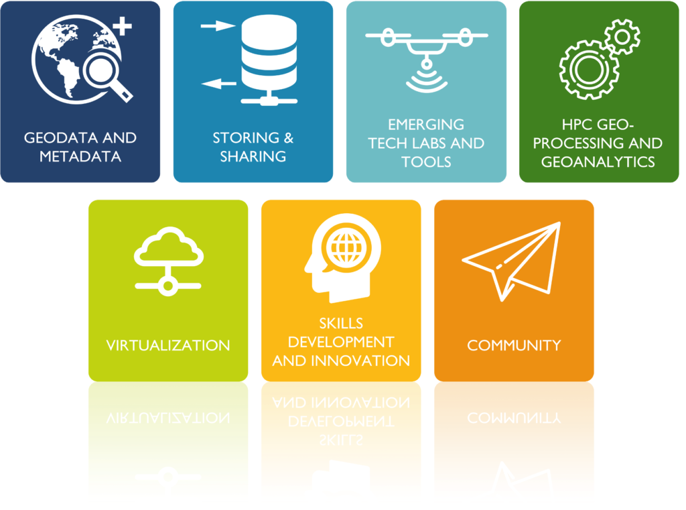
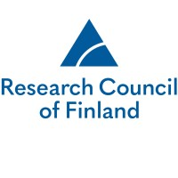
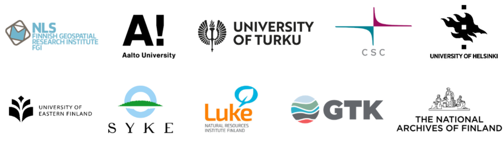

## Project description

**Geoportti Research Infrastructure (RI)** is a shared service for researchers, teachers, and students using geospatial data and geocomputing tools. Geoportti RI helps the researchers in Finland to use, to refine, to preserve, and to share their geospatial resources.

Geoportti RI is a cutting-edge digital research infrastructure that enables scientists to easily access **geospatial data and geocomputing resources through centralised high-performance computing (HPC) and cloud infrastructure** – including tools, workflows, and software libraries. Our aim is to **empower renewal/excellence in science** via widespread use of geographical data and geoinformatics methods; serve as a catalyst for collaboration; and foster creation of disruptive location innovations with broad societal impact.

Geoportti RI provides numerous **services** for researchers, teachers and students (the service categories listed in the image), such as [Geodata and Metadata](https://www.geoportti.fi/services/data/) services that can be used for finding, downloading, accessing, storing and sharing geospatial data; and [HPC Geoprocessing and Geoanalytics](https://www.geoportti.fi/services/hpc-geo-processing-and-geoanalytics/) services that are orchestrated by CSC IT-Center for Science Finland. Read more about the services from [Geoportti RI’s website](https://www.geoportti.fi).

### Learn more

Read more information about Geoportti RI from the project’s official website: [https://geoportti.fi](https://geoportti.fi)

## Funders

## Consortium members

