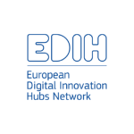
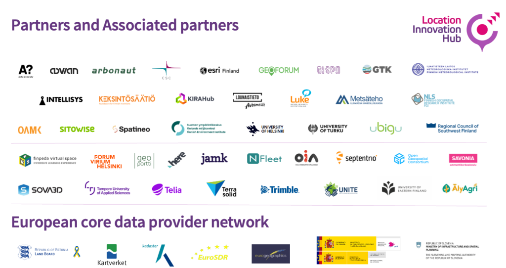

## Project description

**[Location Innovation Hub](https://locationinnovationhub.eu/) (LIH)** is a centre of expertise for location information and technology, offering free coaching for small and medium-sized enterprises and public administrations. We provide support in areas like business development, adopting new technologies, and finding funding opportunities.

Location Innovation Hub is part of the [EDIH network](https://european-digital-innovation-hubs.ec.europa.eu/home), a pan-European partnership of over 150 European Digital Innovation Hubs. We work closely with the three other Finnish Digital Innovation Hubs and connect our clients to a wider network of European Innovation Hubs.

#### Our role

Aalto is mostly participating to the learning and skills development activities of the Location Innovation Hub and currently leading the task focusing on [LIH’s training opportunities](https://locationinnovationhub.eu/en/events-and-learning-opportunities/).

 

#### Team at Aalto

- Dr. Henrikki Tenkanen (Aalto PI)
- Dr. Jussi Nikander
- Dr. Matti Vaaja
- Dr. Maaria Nordman

#### Learn more

Read more information about LIH from the project’s official website: [https://locationinnovationhub.eu](https://locationinnovationhub.eu)

## Funders

## Partner network

