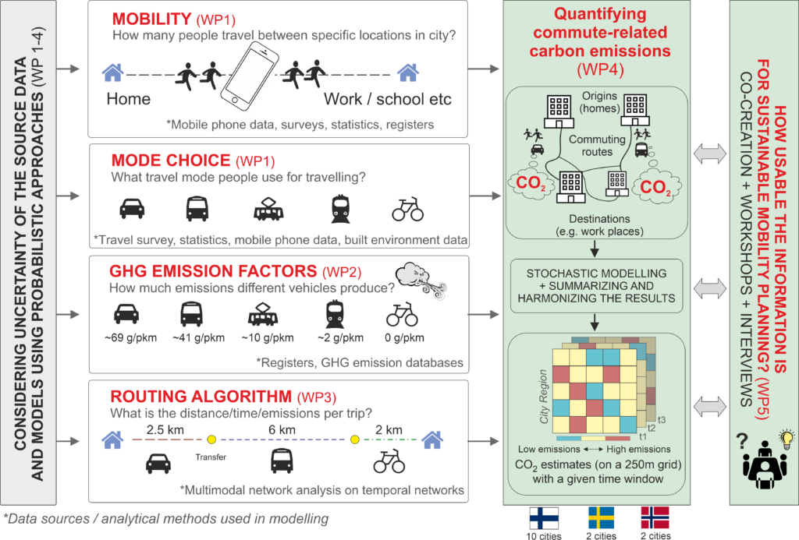
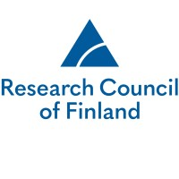
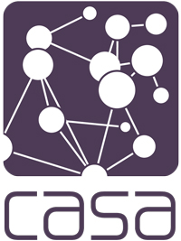
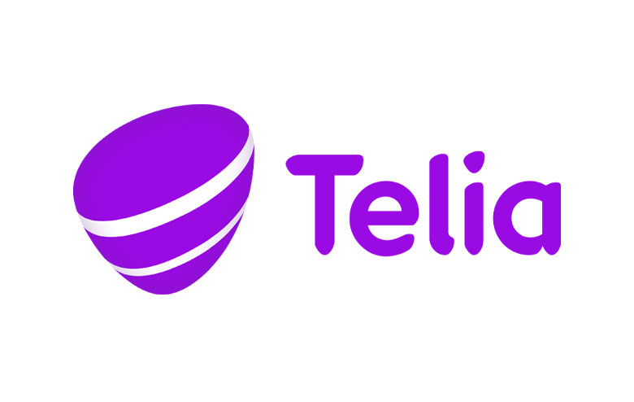

## Project description

**Mapping commute-related carbon emissions with high spatial resolution using big data and probabilistic approaches (MAPICO)** -project aims to develop novel methodology for quantifying carbon emissions in urban areas due to daily commute of people on a statistical grid-level. We will test the methodologies in practice by mapping the commuting-related carbon footprints on a monthly temporal scale in various cities in Finland, Sweden and Norway. We also investigate how such information could be used in practice for transport planning that could help to achieve more sustainable travel behavior. The project (2023-2027) is funded by Research Council of Finland.

## Funders

## Collaborators & Partners

