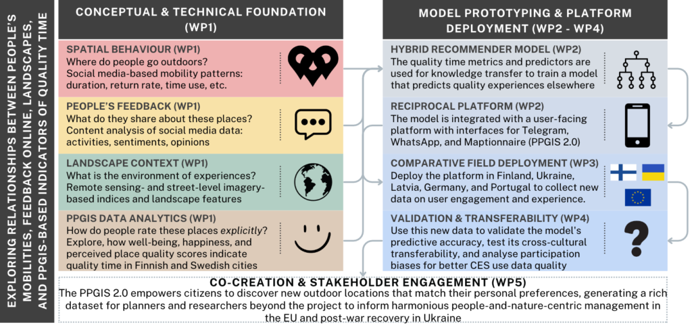

**Project “RECIPRO-GIS: Participatory GIS 2.0 for Reciprocal Engagement and Recommending Cultural Ecosystem Services”** (2026-2030).

The digital transformation of Cultural Ecosystem Services (CES) assessment is slow due to data scarcity and conceptual challenges, so CES are a relatively rare part of real-world environmental management and urban planning. The RECIPRO-GIS project addresses this by developing a next-generation Public Participation GIS (PPGIS 2.0) built on a reciprocal value exchange: it actively crowdsources data on nature-based experiences while providing users with personalised recommendations to discover new locations. A key novelty is the operationalisation of the subjective quality of personal time as a core CES metric, integrated via a recommender system. This approach aims to improve long-term user participation, data quality, and the overall rigour of CES assessment. For this, we will design, validate, and deploy the combination of participatory mapping and recommender model through controlled field experiments across study areas in Finland, Ukraine, Latvia, Germany, and Portugal. .

**Team:**

- Prof. Weiming Huang (University of Leeds)
- Dr Oleksandr Karasov (principal investigator, Aalto University)
- Prof. Marketta Kyttä (Aalto University)
- Prof. Tobias Plieninger (University of Göttingen)
- Prof. Ate Poorthuis (KU Leuven)
- Prof. Tiina Rinne (Tampere University)
- Prof. Henrikki Tenkanen (Aalto University)
- Prof. António Avelino Batista Vieira (University of Minho)
- Dr Anna Wilczyńska (Rīga Stradiņš University)
- ro3kvit Urban coalition for Ukraine

**Funder:** [Research Council of Finland](https://research.fi/en/results/funding/89165)

Follow this project’s updates also on Oleksandr’s projects page: [https://karasov.org/projects](https://karasov.org/projects)

*Work packages of the project*

RECIPRO-GIS continues Oleksandr’s work initiated in the project ‘UkrAInability: Revealing Changes in People-Nature Relationships and Landscape Sustainability in Ukraine Caused by Russia’s Invasion’.

**Duration:** September 2024 – August 2026 (completed)

The project aimed to examine the effects of Russia’s invasion on the relational values of nature in Ukraine through a hybrid approach combining social media and remote sensing data. This project assessed the supply, use, and demand for cultural ecosystem services—such as recreational, aesthetic, and spiritual nature’s contributions that enhance people’s quality of life. By tracking landscape changes since 2015, the project studied how war affected people’s well-being to inform post-war recovery priorities. Additionally, a Telegram bot engaged citizens in mapping these changes, enhancing local participation and validation.

**Team:**

Dr Oleksandr Karasov (postdoc, coordinator / consortium PI, Aalto University)

Prof. Henrikki Tenkanen (supervisor, PI, Aalto University)

**Funded by:** Department of Built Environment, Aalto University

**Outputs:** [ukrainability.space](https://ukrainability.space) (cultural ecosystem services in Kremenchuk mapped via Telegram); [open-source Telegram bot](https://github.com/AaltoGIS/Ukrainability-Telegram-Bot)
